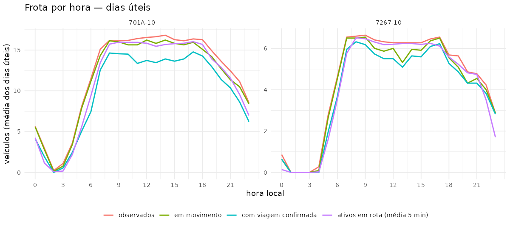
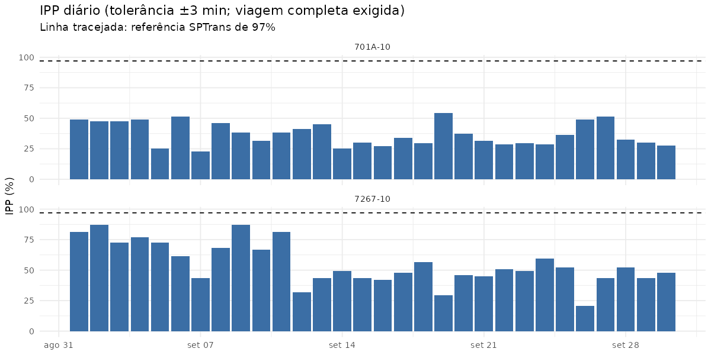
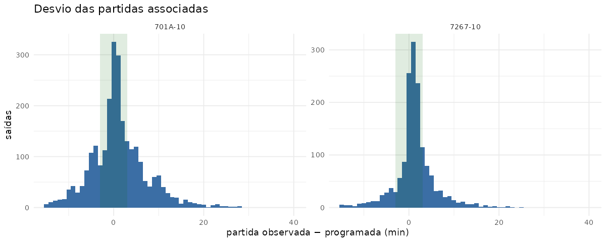

```{r setup}
suppressPackageStartupMessages({library(data.table); library(arrow); library(knitr)})
OUT <- normalizePath("../dados/processados")
G <- file.path(OUT, "graficos")
rk  <- fread(file.path(OUT, "ranking_linhas.csv"))[mes == "2026-09"]
qual <- fread(file.path(OUT, "qualidade_dados.csv"))
inv <- fread(file.path(OUT, "inventario_dados.csv"))
vg <- setDT(read_parquet(file.path(OUT, "viagens_reconstruidas.parquet")))
au <- setDT(read_parquet(file.path(OUT, "auditoria_saidas.parquet")))
sens <- fread(file.path(OUT, "validacao_sensibilidade.csv"))
sl <- fread(file.path(OUT, "diagnostico_sentido_sl.csv"))
gt <- fread(file.path(OUT, "gtfs_escolha_por_linha.csv"))
vf <- fread(file.path(OUT, "verificacoes_consistencia.csv"))
par <- fread(file.path(OUT, "parametros_execucao.csv"))
ver <- fread(file.path(OUT, "versoes_pacotes.csv"))
pct <- function(x) sprintf("%.1f%%", x)
num <- function(x) format(x, big.mark = ".", decimal.mark = ",")
vgs <- vg[service_date >= as.IDate("2026-09-01")]
```

## Resumo executivo

```{r}
r7 <- rk[line_id == "7267-10"]; r1 <- rk[line_id == "701A-10"]
```

- **Observado** — `r num(sum(inv$registros))` posições GPS de `r num(sum(inv$veiculos))` prefixos, de 31/08 23h50 a 30/09 23h59 (horário local). A coleta é estável: intervalo mediano de 44–45 s e menos de 0,3% de intervalos acima de 5 min.
- **Reconstruído (inferência)** — em setembro, a **7267-10** teve `r num(r7$viagens_completas)` voltas completas (confirmadas ou prováveis) e a **701A-10** teve `r num(r1$viagens_completas)` viagens completas (as duas direções somadas). Nos dias úteis, isso dá 48–67 voltas/dia na 7267 (mediana de 59; 69 programadas) e 93–114 viagens/dia na 701A (mediana de 105; 126 programadas).
- **IPP (inferência, sujeita à premissa da programação)** — IPP de **`r pct(r7$IPP_pct)`** na 7267-10 e de **`r pct(r1$IPP_pct)`** na 701A-10, contra a referência de 97% da SPTrans. São `r num(r7$programadas_validas)` e `r num(r1$programadas_validas)` saídas programadas válidas, respectivamente, incluindo domingos e o feriado de 7/9 (tabela de domingo da coleta de 04/11/2026). Saídas *possivelmente não realizadas*: `r num(r7$possivelmente_nao_realizadas)` (`r pct(r7$nao_realizadas_pct)`) e `r num(r1$possivelmente_nao_realizadas)` (`r pct(r1$nao_realizadas_pct)`).
- **Ressalva principal** — a programação usada é a raspagem de **25/10/2026** (dias úteis e sábados) e a coleta de **04/11/2026** (domingos e 7/9), aplicadas a setembro. Se os horários mudaram entre setembro e outubro, os atrasos, antecipações e saídas "não realizadas" ficam inflados. Na 7267, o IPP cai de ~77% (1–11/9) para ~45% (a partir de 12/9), o que é compatível com uma mudança de programação **ou** de operação; não há como distinguir sem a tabela vigente em setembro.

## Dados e qualidade

```{r}
kable(inv[, .(arquivo, tamanho_mb, registros, veiculos, ta_min_utc, ta_max_utc, md5)], caption = "Inventário (hash MD5 dos brutos)")
q <- dcast(qual, indicador ~ linha, value.var = "n")
kable(q, caption = "Indicadores de qualidade por linha (contagens de registros, exceto os intervalos dt_*)")
```

**Achados que orientaram o método:**

1. **As posições do /Posicao já chegam "encaixadas" no itinerário.** A 701A tem só 1.707 coordenadas distintas em 650 mil registros (~1 a cada 30 m de percurso), e cada coordenada pertence quase sempre a um único `sl`. A distância GPS–traçado é praticamente nula, e o erro relevante não é o ruído do GPS: é **em qual itinerário (sentido) o sistema encaixou o ponto**.
2. **Saltos sintéticos entre terminais.** Quando o `sl` é trocado, ou após um período sem sinal, o ônibus pode "saltar" por 1–5 registros para o terminal do sentido marcado (ex.: Vila Madalena → Edu Chaves → Vila Madalena em 2 min). Esses pontos são descartados como *outliers* no map-matching (`quebra = 4`), sem excluir o registro da base normalizada.
3. **A marcação `sl` é um indicador fraco do sentido real.** O sentido inferido pela posição e pela ordem temporal discorda do `sl` em 11,8% dos pontos com `sl = 2` na 701A. Na circular 7267, o `sl` troca de 1 para 2 em torno do km 8,1 (Pça. Ramos), mas 10% das trocas acontecem já no km 0:

```{r}
kable(sl, caption = "Marcação sl × sentido inferido (701A) e posição das trocas de sl na circular (7267)")
kable(gt, caption = "Versão do GTFS escolhida por linha (fração dos pontos GPS a até 50 m do traçado)")
```

## Método

**Ciclo da linha.** Cada linha vira uma polilinha **fechada** em metros (UTM 23S). Nas linhas com dois sentidos, ela é o shape do sentido 0 (TP→TS) seguido do shape do sentido 1 (TS→TP); nas circulares, é o próprio shape, que começa e termina no TP. O ônibus só avança no ciclo. A troca de sentido é inferida quando ele **cruza** a posição do TS (ou do TP), e não pela marcação `sl`. Para cada linha, a versão do GTFS é escolhida pelo melhor ajuste aos pontos GPS: a 20260226 tem calendário até 01/09/2026 e traçado diferente na 7267.

**Map-matching (HMM/Viterbi, C++).** Para cada posição, os candidatos são todos os mínimos locais de distância ao ciclo num raio de 120 m; uma via usada nos dois sentidos gera dois candidatos. O Viterbi escolhe a sequência que avança (recuo tolerado de 60 m), respeita a velocidade máxima de 70 km/h e tem a distância percorrida no ciclo mais próxima da distância em linha reta. A cadeia é quebrada quando o veículo **para de transmitir** por mais de 30 min. Ficar fora do traçado mas transmitindo (dentro do terminal, por exemplo) não quebra a cadeia. O progresso "desenrolado" `u` conta as voltas.

**Viagens.** Uma viagem candidata é a passagem de uma cadeia pelo intervalo de progresso do sentido *k* na volta *n*. A **partida** é o instante (interpolado) em que se cruza TP/TS + 50 m. Quando o par de pontos que cerca esse limiar tem lacuna, mas o ponto seguinte está a até 500 m, a partida é estimada pela velocidade de manobra (15 km/h). A **chegada** é o cruzamento do fim do sentido − 150 m. A **cobertura** é a fração do percurso coberta por pares de pontos com intervalo ≤ 300 s, o critério de "sem transmissão" do IDTA.

| Classe | Critério |
|---|---|
| `viagem_confirmada` | partida e chegada evidenciadas, cobertura ≥ 90%, lacuna máxima ≤ 10 min, velocidade média entre 4 e 45 km/h |
| `viagem_provavel` | partida e chegada evidenciadas, cobertura ≥ 70% |
| `trajetoria_parcial` | ≥ 25% do percurso observado |
| `observacao_inconclusiva` | demais casos (≥ 1 km observado) |

Na classificação de veículo-dia também aparecem `movimento_sem_itinerario` e `sem_evidencia_de_operacao` (arquivo `veiculos_dia.csv`).

**Passagens por ponto.** Para cada viagem e cada parada do sentido, o horário é obtido por interpolação linear do progresso entre as duas posições que cercam a parada. As paradas são projetadas no traçado respeitando a ordem de `stop_sequence`, o que é necessário nos laços em que a linha passa duas vezes pela mesma via (paradas 5–7 e 41–43 da 7267). A passagem é marcada como `interpolado_sobre_lacuna` quando o par de pontos tem intervalo acima de 300 s.

**Auditoria (IPP).** As saídas programadas são associadas às partidas observadas por **alinhamento ordenado global** (programação dinâmica), por linha × sentido × dia de serviço. Uma viagem justifica no máximo uma saída, e uma saída "pulada" fica sem par em vez de deslocar as seguintes. A janela de associação vai de −15 a +40 min. Tolerância de pontualidade: **±3 min** (IQT.GSO.002.03).

| Status da saída | Regra |
|---|---|
| `realizada_no_horario` | associada, \|dif\| ≤ 3 min **e** viagem confirmada ou provável |
| `realizada_com_atraso` / `realizada_antecipadamente` | associada, dif > +3 min / < −3 min, viagem completa |
| `partida_sem_viagem_completa` | houve partida no terminal, mas o percurso não foi comprovado |
| `possivelmente_nao_realizada` | sem partida compatível, com GPS da linha em ≥ 50% dos minutos da janela [−20, +60] min |
| `inconclusiva` | sem partida e sem dados suficientes, **ou** com algum ônibus em serviço sem transmitir no horário |
| `programacao_invalida` / `fora_do_periodo_coletado` | fora do denominador |

IPP = `realizada_no_horario` / saídas válidas × 100. Como o usuário pediu, a partida só conta se o ônibus **cumpriu a viagem**. Por isso este IPP é mais exigente que o da SPTrans, que conta apenas partidas pontuais.

## Resultados — reconstrução

```{r}
t1 <- dcast(vgs[, .N, by = .(line_id, direction_id, trajectory_status)], line_id + direction_id ~ trajectory_status, value.var = "N", fill = 0)
kable(t1, caption = "Viagens candidatas por classe (setembro)")
t2 <- vgs[trajectory_status == "viagem_confirmada", .(viagens = .N, duracao_mediana_min = round(median(duration_minutes)),
          p10 = round(quantile(duration_minutes, .1)), p90 = round(quantile(duration_minutes, .9)),
          vel_media_kmh = round(median(vel_media_kmh), 1), km = round(median(distance_km), 1)), by = .(line_id, direction_id)]
kable(t2, caption = "Viagens confirmadas: duração e velocidade")
```



## Resultados — auditoria das saídas

```{r}
kable(rk[, .(line_id, programadas_total, programadas_validas, no_horario, com_atraso, antecipadas,
             partida_sem_viagem_completa, possivelmente_nao_realizadas, inconclusivas, IPP_pct, realizadas_pct,
             nao_realizadas_pct)], caption = "Setembro/2026 — denominador = saídas programadas válidas (dias úteis e sábados)")
ms <- fread(file.path(OUT, "ipp_mensal_por_sentido.csv"))[mes == "2026-09"]
kable(ms[, .(line_id, direction_id, programadas_validas, no_horario, com_atraso, antecipadas, possivelmente_nao_realizadas, IPP_pct)], caption = "Por sentido")
```





```{r}
h <- fread(file.path(OUT, "ranking_linhas_horario.csv"))[tipo_dia == "U"]
kable(dcast(h, hora_prog ~ line_id, value.var = "IPP_pct"), caption = "IPP por hora da saída programada (dias úteis)")
```

## Sensibilidade

```{r}
kable(sens[, .(line_id, parametro, valor, central = cenario_central, viagens_confirmadas, viagens_provaveis,
               trajetorias_parciais, IPP_pct, realizadas_pct, possivelmente_nao_realizadas)])
```

A reconstrução é estável dentro das faixas testadas: o raio de 80 a 200 m, a lacuna de 180 a 600 s e o limiar de cobertura de 80 a 95% mudam as viagens confirmadas em menos de 4%. O IPP depende quase só da tolerância de pontualidade. A contagem de saídas "não realizadas" fica praticamente inalterada.

## Limitações e recomendações

- **Programação.** Na raspagem de 25/10/2026 (navegador) a tabela de domingo é cópia da de dia útil e é descartada; domingos e 7/9 usam a coleta de 04/11/2026, feita pela API da SPTrans (`coleta_horarios_programados/`), cuja tabela D é correta. Para cada data, linha e sentido, o pipeline usa a coleta válida mais recente anterior a ela ou, na falta, a mais próxima posterior. Novas coletas são lidas automaticamente.
- **Partida observada ≠ partida do SIM.** O instante adotado é o cruzamento do TP + 50 m nas posições já encaixadas pelo Olho Vivo. A resolução é de ~45 s; a regra pode diferir da regra oficial, que usa pontos notáveis.
- **Sem validação independente.** Não há registros oficiais de partidas para medir precisão e sensibilidade. Recomenda-se conferir em mapa uma amostra estratificada, com o `trip_id` de `auditoria_saidas.parquet` e as posições de `posicoes_normalizadas`.
- **Ausência de GPS não é prova de descumprimento.** Saídas que caem em lacunas de transmissão de ônibus em serviço são classificadas como `inconclusiva`.
- **Escala.** A unidade de processamento é a linha, em paralelo. O map-matching leva ~4 s por linha-mês nas linhas testadas, e o pipeline completo (incluindo a sensibilidade) levou ~1,4 min. Com a sensibilidade desligada (`cfg$rodar_sensibilidade = FALSE`), o custo por linha-mês fica em ~15–40 s, dominado pela leitura e pelo QC.

## Verificações automáticas

```{r}
kable(vf)
```

## Reprodução

```bash
cd projeto_onibus
Rscript run_pipeline.R
quarto render relatorios/relatorio.qmd
```

```{r}
kable(ver, caption = "Versões")
kable(par, caption = "Parâmetros desta execução")
```

## Trechos dos scripts executados

```{r, file="../R/04_viagens.R", eval=FALSE, echo=TRUE}
```

```{r, file="../R/07_auditoria.R", eval=FALSE, echo=TRUE}
```
